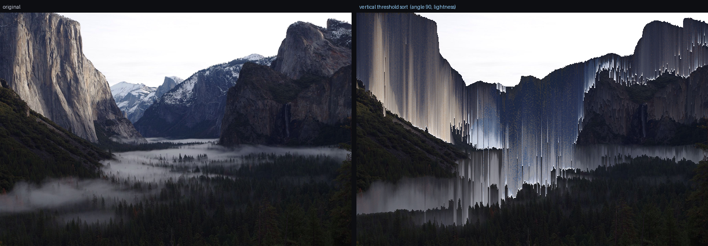

# psort

**[psort.muratkoptur.com](https://psort.muratkoptur.com)**

A client-side pixel sorter. Load an image, drag sliders, watch pixels melt in
real time, export at full resolution. Everything runs in the browser — no upload,
no server, your image never leaves the page.



## What it does

Pixel sorting reorders pixels along lines through the image, but only within
intervals chosen by some rule. The result is the familiar glitch "drip": smooth
gradients where scan-lines got sorted, sharp edges where they didn't.

- **Any angle** — 0–360° via a bucket-and-sort traversal (no rotate/resample), plus horizontal/vertical fast paths.
- **Sort keys** — lightness, hue, saturation, intensity, or a raw R/G/B channel, ascending or descending.
- **Interval methods** — `threshold` (sort within a brightness band, or *outside* it with invert), `full` line, `random`, `wave`, `fixed chunk`, and `edge` (Sobel boundaries).
- **Chunk clamp** — min/max interval length applied on top of any method.
- **Multi-pass** — stack passes with independent params, reorder them, or load the Asendorf vertical→horizontal preset.
- **Interval overlay** — a diagnostic view that tints which spans get sorted.
- **Deterministic** — a seeded PRNG (xorshift32) means the same params always give the same pixels.
- **Sharable** — the whole parameter state lives in the URL hash, so reload and link-sharing just work.
- **Off-thread** — sorting runs in a Web Worker; the UI stays live, and full-res export has a progress bar and cancel.

## Quick start

```bash
npm install
npm run dev      # http://localhost:5173
```

Load an image (button, drag-drop, or paste), tweak, then **export PNG** for the
full-resolution result. The preview works on a downscaled copy; export runs the
same code path at native resolution.

```bash
npm test         # headless engine tests (node --test, no DOM)
npm run build    # production build to dist/
```

## License

© 2026 Murat Koptur
